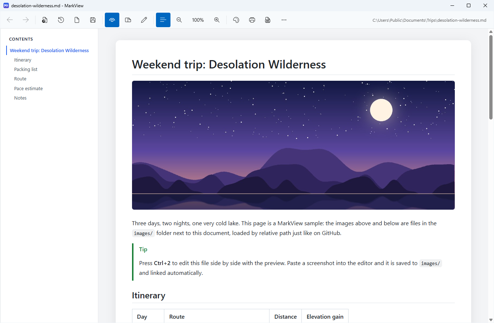
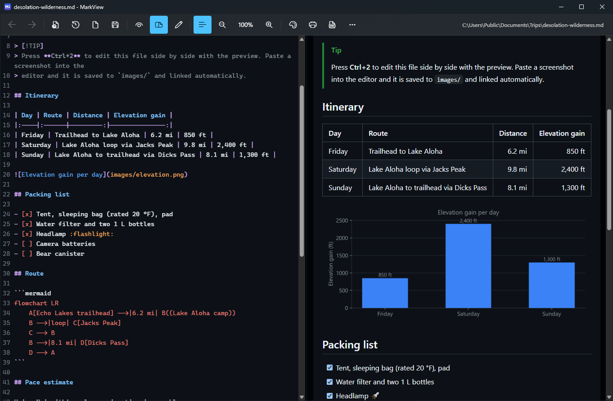
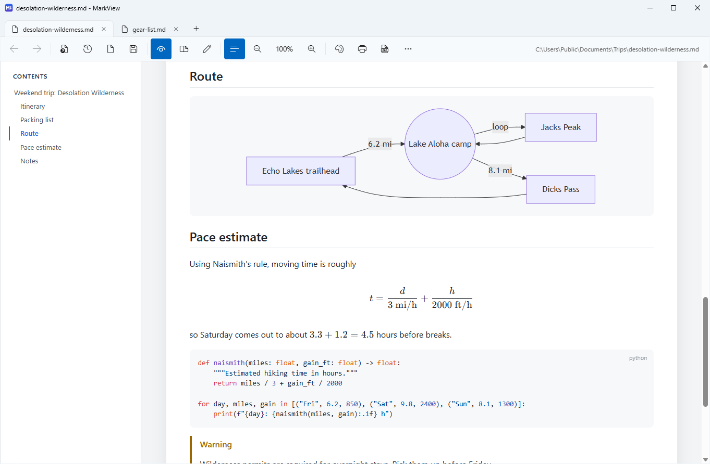
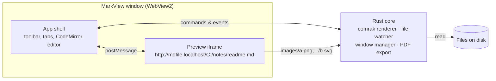

<div align="center">


# MarkView

**A fast, good-looking Markdown viewer and editor for Windows that actually shows your images.**

[](#requirements)
[](https://www.rust-lang.org/)
[](https://tauri.app/)
[](https://github.com/jgrimard/MarkView/releases/latest)
[](LICENSE)

[Download](https://github.com/jgrimard/MarkView/releases/latest) ·
[Features](#features) ·
[Screenshots](#screenshots) ·
[Keyboard shortcuts](#keyboard-shortcuts) ·
[Building from source](#building-from-source)

<br />



</div>

## Why MarkView?

Many Markdown viewers show broken images for anything stored next to the document, such as
``, `` or `../assets/logo.svg`. They render the
HTML from a string, so the page has no folder to resolve those paths against.

MarkView serves every document from **its own folder**, the same way a web server or GitHub does, so
relative paths just work. It also handles the cases GitHub doesn't:

| Image reference | Example | MarkView |
|---|---|:---:|
| Relative path | `` | ✅ |
| Parent folder | `` | ✅ |
| Raw HTML | `` | ✅ |
| Absolute Windows path, even with spaces | `` | ✅ |
| UNC / network share | `` | ✅ |
| `file:///` URL | `` | ✅ |
| Remote image | `` | ✅ |

The whole app is a **single ~7 MB executable**. There's no installer and no runtime to download.

## Features

**Reading**
- GitHub-flavored rendering: tables, task lists, footnotes, alerts (`> [!NOTE]`), emoji shortcodes, heading anchors
- Syntax highlighting for 50 languages, with a copy button on every code block
- [Mermaid](https://mermaid.js.org/) diagrams and [KaTeX](https://katex.org/) math (`$inline$` and `$$display$$`)
- Collapsible table of contents that tracks your scroll position
- Click any image to view it full size
- Light, dark, or system theme, with Windows 11 Mica and your accent color

**Editing**
- Built-in [CodeMirror 6](https://codemirror.net/) editor with Read, Split, and Edit modes
- Live preview as you type, with the preview scrolling in sync with the editor
- Double-click anything in the preview to jump to its source line
- **Paste a screenshot** to save it to `images/` and insert a link
- Drag files from Explorer onto the editor to insert relative links
- Tick task-list checkboxes in the preview to update the source
- Keeps each file's line endings (CRLF or LF) and UTF-8 byte-order mark as they were

**Working with files**
- **Live reload**: the preview updates when the file, or any image it shows, changes on disk
- Links to other `.md` files open in place, with Back/Forward. Ctrl+click opens them in a new window.
- Each document opens in its own window by default. Tabs are one click away (**⋯ > Open files in tabs**).
- Print, or export to PDF with images, diagrams, and math intact
- Recent files, drag-and-drop to open, single-instance file handling
- Offers to become your default `.md` app on first run. This is per-user and needs no admin rights.

## Screenshots

<div align="center">

**Split editor with live preview (dark theme)**



<br /><br />

**Tabs, table of contents, Mermaid diagrams, math, and code**



</div>

## Installation

1. Download `MarkView.exe` from the [latest release](https://github.com/jgrimard/MarkView/releases/latest).
2. Put it in a permanent folder, for example `%LOCALAPPDATA%\Programs\MarkView\`.
3. Run it. MarkView asks whether it should open `.md` files. If you say yes, Windows Settings opens so you can confirm it as the default app.

> [!IMPORTANT]
> The file association points at the exact location of `MarkView.exe`. If you move it later, open it once
> from the new location and MarkView will offer to set things up again. You can also use
> **⋯ > Re-register .md files here**.

You can also open files from the command line:

```powershell
MarkView.exe README.md docs\guide.md
```

### Requirements

- Windows 10 or 11 (x64)
- [Microsoft Edge WebView2 Runtime](https://developer.microsoft.com/microsoft-edge/webview2/). It's preinstalled on Windows 11 and on up-to-date Windows 10.

## Keyboard shortcuts

| Shortcut | Action |
|---|---|
| <kbd>Ctrl</kbd>+<kbd>O</kbd> / <kbd>Ctrl</kbd>+<kbd>N</kbd> | Open file / new document |
| <kbd>Ctrl</kbd>+<kbd>S</kbd> / <kbd>Ctrl</kbd>+<kbd>Shift</kbd>+<kbd>S</kbd> | Save / save as |
| <kbd>Ctrl</kbd>+<kbd>1</kbd> / <kbd>2</kbd> / <kbd>3</kbd> | Read / split / edit mode |
| <kbd>Ctrl</kbd>+<kbd>E</kbd> | Cycle view mode |
| <kbd>Ctrl</kbd>+<kbd>T</kbd> | Toggle table of contents |
| <kbd>Ctrl</kbd>+<kbd>F</kbd> | Find in the editor |
| <kbd>Ctrl</kbd>+<kbd>=</kbd> / <kbd>-</kbd> / <kbd>0</kbd> | Zoom in / out / reset (or <kbd>Ctrl</kbd>+mouse wheel) |
| <kbd>Alt</kbd>+<kbd>←</kbd> / <kbd>→</kbd> | Back / forward between linked documents |
| <kbd>F5</kbd> | Reload from disk |
| <kbd>Ctrl</kbd>+<kbd>P</kbd> | Print |
| <kbd>Ctrl</kbd>+<kbd>W</kbd> | Close document |
| <kbd>Ctrl</kbd>+<kbd>Tab</kbd> | Next tab (when tabs are on) |

## How it works



- The preview for `C:\notes\readme.md` loads from `http://mdfile.localhost/C:/notes/readme.md`, served by a
  custom protocol handler in Rust. Because the page's URL is the document's own folder, the browser resolves
  relative images exactly as it would on a web server.
- Markdown is rendered by [comrak](https://github.com/kivikakk/comrak) (GitHub-flavored Markdown) with source
  positions, which drive editor/preview scroll sync and task-list toggling.
- Preview pages run under a strict Content Security Policy. Only MarkView's own scripts can run, so raw HTML
  in a document can't execute code. MarkView sends no telemetry. The only network requests come from
  remote images or links in your documents.

## Building from source

Prerequisites: [Rust](https://rustup.rs/) (stable, 1.82 or newer) and the MSVC build tools. You only need
[Node.js](https://nodejs.org/) 18+ if you change the editor bundle.

```powershell
git clone https://github.com/jgrimard/MarkView.git
cd MarkView\src-tauri

cargo test
cargo build --release
# -> src-tauri\target\release\markview.exe (all assets are embedded)
```

To rebuild the CodeMirror editor bundle (`ui/editor.bundle.js`) after editing `editor-src/editor.mjs`:

```powershell
cd editor-src
npm install
npm run build
```

### Project layout

| Path | Contents |
|---|---|
| [`src-tauri/`](src-tauri) | Rust app: protocol handler, Markdown rendering, windows, file watching, PDF export, file association |
| [`ui/`](ui) | Front end embedded in the exe: app shell, preview page, vendored libraries |
| [`editor-src/`](editor-src) | Source for the CodeMirror 6 editor bundle |
| [`samples/`](samples) | Test documents covering every image-path case, plus the showcase used for the screenshots |
| [`docs/images/`](docs/images) | Logo and screenshots for this README |

Settings are stored in `%LOCALAPPDATA%\MarkView\markview.json`.

## Acknowledgements

MarkView is built on [Tauri](https://tauri.app/), [comrak](https://github.com/kivikakk/comrak),
[CodeMirror](https://codemirror.net/), [Mermaid](https://mermaid.js.org/), [KaTeX](https://katex.org/),
[highlight.js](https://highlightjs.org/) and [github-markdown-css](https://github.com/sindresorhus/github-markdown-css).
See [THIRD_PARTY_NOTICES.md](THIRD_PARTY_NOTICES.md) for their licenses.

## License

[MIT](LICENSE) © jgrimard
