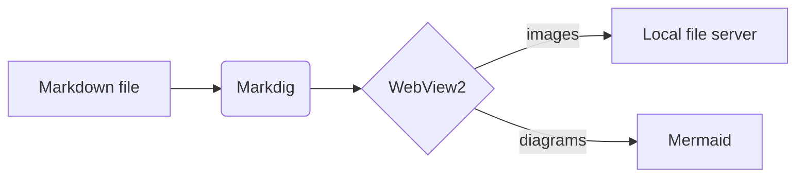

# MarkView test document

This file exercises every kind of image reference and the main Markdown features.

## Images

### Relative path


### Parent-relative path


### Absolute Windows path

> The two absolute-path examples below point at where this repository lived on the author's machine.
> Edit them to match your clone to test absolute paths.


### file:/// URL


### Raw HTML with width

<p align="center">
  
</p>

### Spaces and Unicode in the file name


### Animated GIF


### Remote images

 

### Missing image (should show a red placeholder)


## Text features

A paragraph with **bold**, *italic*, ~~strikethrough~~, `inline code`, a footnote[^1], an emoji :rocket:,
and a [link to another document](other.md) plus an [external link](https://github.com).

> [!NOTE]
> GitHub-style alert blocks are supported.

> [!WARNING]
> So are warnings.

### Task list

- [x] Render images correctly
- [ ] Toggle me (this edits the source)
- [ ] Me too

### Table

| Feature | MarkLight | MarkView |
|:--------|:---------:|:--------:|
| Local images | No | Yes |
| Live reload | No | Yes |
| Editor | No | Yes |

## Code

```csharp
public static string Greet(string name) => $"Hello, {name}!";
```

```python
def fib(n):
    a, b = 0, 1
    for _ in range(n):
        a, b = b, a + b
    return a
```

```powershell
Get-ChildItem -Recurse -Filter *.md | Select-Object FullName
```

## Mermaid



## Math

Inline math $E = mc^2$ and a display equation:

$$
\int_0^\infty e^{-x^2}\,dx = \frac{\sqrt{\pi}}{2}
$$

[^1]: This is the footnote text.
