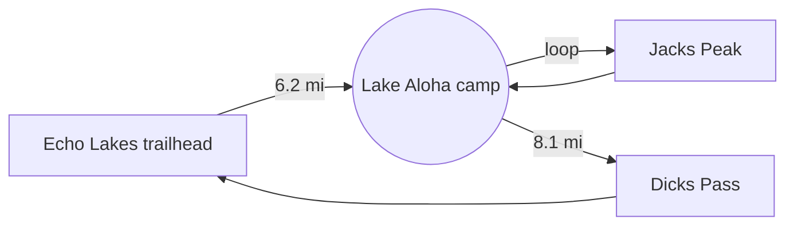

# Weekend trip: Desolation Wilderness


Three days, two nights, one very cold lake. This page is a MarkView sample: the images above and
below are files in the `images/` folder next to this document, loaded by relative path just like on GitHub.

> [!TIP]
> Press **Ctrl+2** to edit this file side by side with the preview. Paste a screenshot into the
> editor and it is saved to `images/` and linked automatically.

## Itinerary

| Day | Route | Distance | Elevation gain |
|:----|:------|---------:|---------------:|
| Friday | Trailhead to Lake Aloha | 6.2 mi | 850 ft |
| Saturday | Lake Aloha loop via Jacks Peak | 9.8 mi | 2,400 ft |
| Sunday | Lake Aloha to trailhead via Dicks Pass | 8.1 mi | 1,300 ft |


## Packing list

- [x] Tent, sleeping bag (rated 20 °F), pad
- [x] Water filter and two 1 L bottles
- [x] Headlamp :flashlight:
- [ ] Camera batteries
- [ ] Bear canister

## Route



## Pace estimate

Using Naismith's rule, moving time is roughly

$$
t = \frac{d}{3\ \text{mi/h}} + \frac{h}{2000\ \text{ft/h}}
$$

so Saturday comes out to about $3.3 + 1.2 = 4.5$ hours before breaks.

```python
def naismith(miles: float, gain_ft: float) -> float:
    """Estimated hiking time in hours."""
    return miles / 3 + gain_ft / 2000

for day, miles, gain in [("Fri", 6.2, 850), ("Sat", 9.8, 2400), ("Sun", 8.1, 1300)]:
    print(f"{day}: {naismith(miles, gain):.1f} h")
```

> [!WARNING]
> Wilderness permits are required for overnight stays. Pick them up before Friday.

## Notes

Water was plentiful at every lake crossing[^water]. The best views are from the saddle just past
Dicks Lake; plan to get there before noon when the wind picks up.

[^water]: Late-season trips may find the smaller streams dry.
