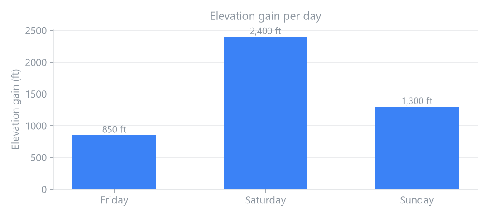
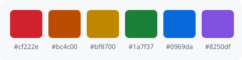
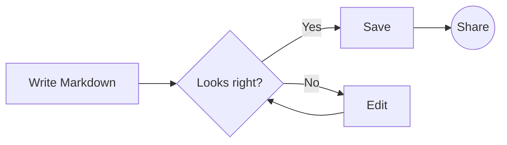
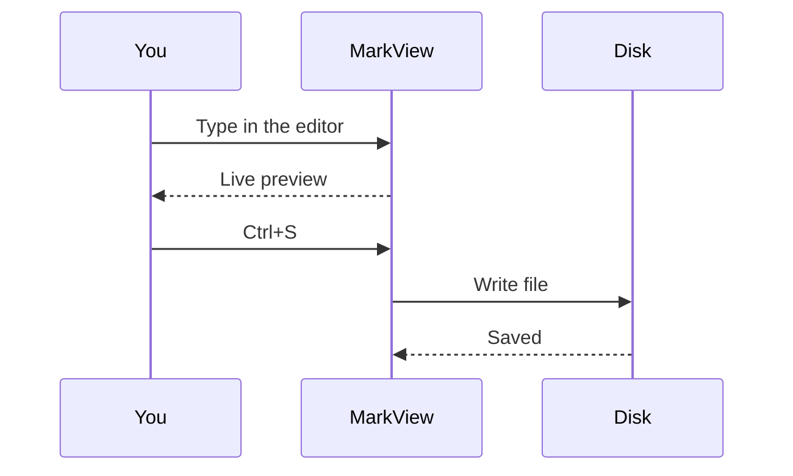
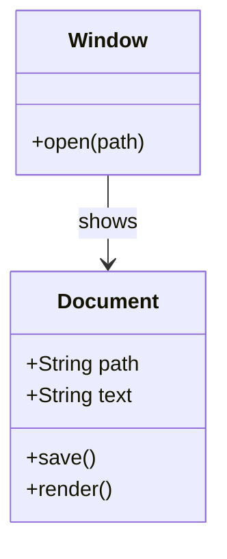
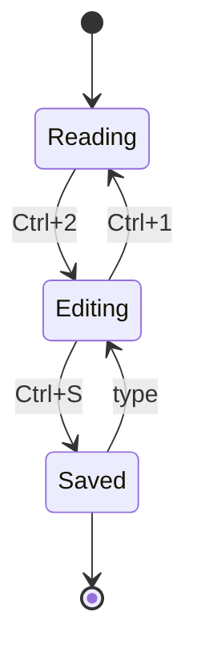
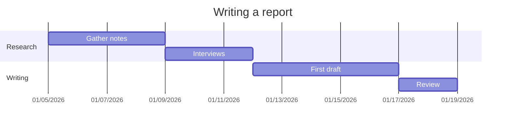
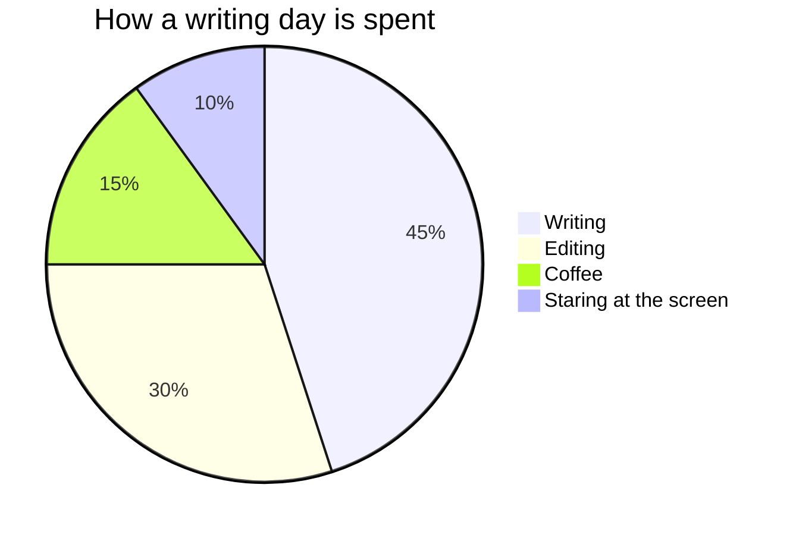
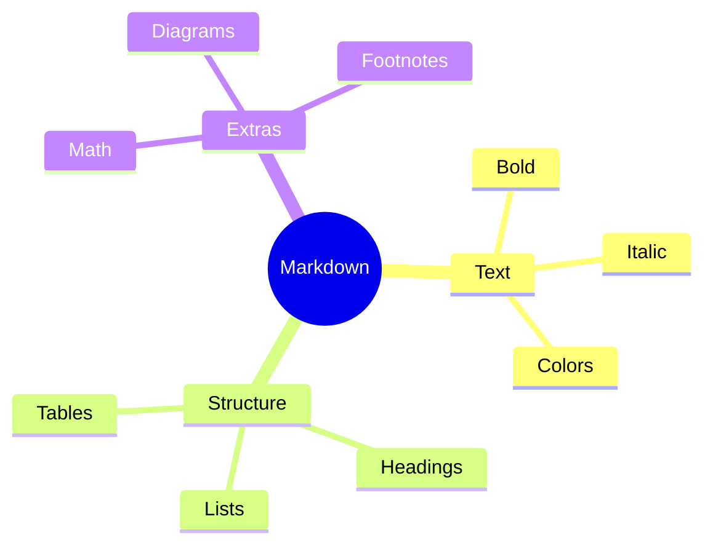

# Markdown examples

Welcome! This page is a tour of everything MarkView can display, from simple **bold** text to colors, math and diagrams. Each section shows the result first, followed by the Markdown that produces it.

> [!TIP]
> This is your own scratch copy. Change anything you like in the editor on the left and the preview updates as you type. Nothing here is saved unless you choose **Save As** (<kbd>Ctrl</kbd>+<kbd>S</kbd>), and the next time you open the examples they start fresh.

**Contents**

1. [Headings](#headings)
2. [Paragraphs and line breaks](#paragraphs-and-line-breaks)
3. [Text styles](#text-styles)
4. [Colors](#colors)
5. [Font size and alignment](#font-size-and-alignment)
6. [Blockquotes](#blockquotes)
7. [Alerts](#alerts)
8. [Lists](#lists)
9. [Links](#links)
10. [Images](#images)
11. [Tables](#tables)
12. [Code](#code)
13. [Math](#math)
14. [Diagrams](#diagrams)
15. [Footnotes](#footnotes)
16. [Definition lists](#definition-lists)
17. [Emoji](#emoji)
18. [Collapsible sections](#collapsible-sections)
19. [Horizontal rules](#horizontal-rules)
20. [Escaping special characters](#escaping-special-characters)
21. [Comments](#comments)
22. [Front matter](#front-matter)
23. [Handy shortcuts](#handy-shortcuts)

---

## Headings

Start a line with one to six `#` characters. More `#` means a smaller heading. Headings also appear in the table of contents (<kbd>Ctrl</kbd>+<kbd>T</kbd>).

<!-- The samples on this page use HTML headings so they stay out of the table of contents. -->
<div style="border:1px solid rgba(128,128,128,0.35); border-radius:6px; padding:4px 16px">
<h1>Heading 1</h1>
<h2>Heading 2</h2>
<h3>Heading 3</h3>
<h4>Heading 4</h4>
<h5>Heading 5</h5>
<h6>Heading 6</h6>
</div>

```markdown
# Heading 1
## Heading 2
### Heading 3
#### Heading 4
##### Heading 5
###### Heading 6
```

The two largest levels can also be written by underlining the text with `=` or `-`:

<div style="border:1px solid rgba(128,128,128,0.35); border-radius:6px; padding:4px 16px">
<h1>Underlined heading 1</h1>
<h2>Underlined heading 2</h2>
</div>

```markdown
Underlined heading 1
====================

Underlined heading 2
--------------------
```

---

## Paragraphs and line breaks

A blank line starts a new paragraph. Lines that follow each other directly are joined into one paragraph,
like these two.

To break a line without starting a new paragraph, end it with a backslash\
or with two spaces  
or use an HTML tag.<br>Each of these starts a new line.

```markdown
A blank line starts a new paragraph.

End a line with a backslash\
or with two spaces··
or use an HTML tag.<br>Each of these starts a new line.
```

(The `··` above stands for two spaces.)

---

## Text styles

| Result | Markdown |
|:-------|:---------|
| **Bold** or __Bold__ | `**Bold**` or `__Bold__` |
| *Italic* or _Italic_ | `*Italic*` or `_Italic_` |
| ***Bold and italic*** | `***Bold and italic***` |
| ~~Strikethrough~~ | `~~Strikethrough~~` |
| `Inline code` | `` `Inline code` `` |
| <u>Underline</u> | `<u>Underline</u>` |
| <mark>Highlight</mark> | `<mark>Highlight</mark>` |
| H<sub>2</sub>O | `H<sub>2</sub>O` |
| E = mc<sup>2</sup> | `E = mc<sup>2</sup>` |
| <kbd>Ctrl</kbd>+<kbd>C</kbd> | `<kbd>Ctrl</kbd>+<kbd>C</kbd>` |
| <abbr title="HyperText Markup Language">HTML</abbr> (hover me) | `<abbr title="HyperText Markup Language">HTML</abbr>` |

Styles can be combined: **bold with *italic* inside**, or ~~**struck-out bold**~~.

---

## Colors

Plain Markdown has no color syntax, but MarkView understands inline HTML, so a `<span>` with a `style` does the job.

Text can be <span style="color:#cf222e">red</span>, <span style="color:#1a7f37">green</span>, <span style="color:#0969da">blue</span>, <span style="color:#8250df">purple</span> or <span style="color:#bc4c00">orange</span>.

You can also give it a <span style="background:#fff8c5; color:#24292f; padding:0 4px; border-radius:4px">highlighted background</span> or a <span style="background:#0969da; color:#ffffff; padding:2px 8px; border-radius:12px">badge look</span>.

```markdown
Text can be <span style="color:#cf222e">red</span> or <span style="color:#1a7f37">green</span>.

A <span style="background:#fff8c5; color:#24292f; padding:0 4px">highlighted background</span>.
```

Colors can also be written with math. This trick works on GitHub too, where HTML styles are removed: $\color{#cf222e}{\text{red}}$, $\color{#1a7f37}{\text{green}}$, $\color{#0969da}{\text{blue}}$.

```markdown
$\color{#cf222e}{\text{red}}$, $\color{#1a7f37}{\text{green}}$
```

Colors work anywhere HTML does, for example in a whole block:

<div style="border-left:4px solid #8250df; background:rgba(130,80,223,0.1); padding:8px 16px; border-radius:6px">
A custom callout box with a purple edge.
</div>

```markdown
<div style="border-left:4px solid #8250df; background:rgba(130,80,223,0.1); padding:8px 16px">
A custom callout box with a purple edge.
</div>
```

---

## Font size and alignment

Font size also comes from HTML: <span style="font-size:0.8em">small</span>, normal, <span style="font-size:1.4em">larger</span>, <span style="font-size:2em">much larger</span>. The `<small>` tag works for <small>fine print</small>.

```markdown
<span style="font-size:0.8em">small</span>, normal, <span style="font-size:1.4em">larger</span>,
<span style="font-size:2em">much larger</span>. <small>fine print</small>
```

Fonts can be changed the same way: <span style="font-family:Georgia, serif">a serif font</span>, <span style="font-family:Consolas, monospace">a monospace font</span>, <span style="font-variant:small-caps">small capitals</span>.

```markdown
<span style="font-family:Georgia, serif">a serif font</span>
```

<p align="center">This paragraph is centered.</p>

<p align="right">This one is aligned to the right.</p>

```markdown
<p align="center">This paragraph is centered.</p>

<p align="right">This one is aligned to the right.</p>
```

---

## Blockquotes

> Start a line with `>` to quote it.
>
> A quote can hold several paragraphs, **formatting**, and lists:
>
> - first point
> - second point
>
> > Quotes can also be nested.

```markdown
> Start a line with `>` to quote it.
>
> A quote can hold several paragraphs, **formatting**, and lists:
>
> - first point
> - second point
>
> > Quotes can also be nested.
```

---

## Alerts

Alerts are blockquotes with a special first line. They come in five kinds.

> [!NOTE]
> Useful information that users should know, even when skimming.

> [!TIP]
> Helpful advice for doing things better or more easily.

> [!IMPORTANT]
> Key information users need to achieve their goal.

> [!WARNING]
> Urgent information that needs immediate attention to avoid problems.

> [!CAUTION]
> Advises about risks or negative outcomes of certain actions.

```markdown
> [!NOTE]
> Useful information that users should know, even when skimming.

> [!WARNING]
> Urgent information that needs immediate attention to avoid problems.
```

The other kinds are `[!TIP]`, `[!IMPORTANT]` and `[!CAUTION]`.

---

## Lists

**Bulleted lists** start each line with `-`, `*` or `+`. Indent to nest them.

- Fruit
  - Apples
  - Oranges
- Vegetables
  - Carrots
    - Orange ones
    - Purple ones

* Asterisks work too
* for bullets

+ and so do
+ plus signs

**Numbered lists** start with a number and a period. The first number sets where counting begins; the rest can all be `1.`.

1. Preheat the oven
1. Mix the ingredients
1. Bake for 25 minutes

To start somewhere else, begin with that number:

7. This list starts at seven
8. and keeps counting

**Mixed lists** combine both:

1. Pack the bag
   - Water
   - Snacks
2. Leave the house

```markdown
- Fruit
  - Apples
  - Oranges

* Asterisks work too

+ and so do

1. Preheat the oven
1. Mix the ingredients

To start somewhere else:

7. This list starts at seven
8. and keeps counting

1. Pack the bag
   - Water
2. Leave the house
```

**Task lists** add `[ ]` or `[x]`. In MarkView you can click the boxes, even in read mode, and the Markdown updates to match.

- [x] Install MarkView
- [x] Open the examples
- [ ] Write something great
- [ ] Save it with <kbd>Ctrl</kbd>+<kbd>S</kbd>

```markdown
- [x] Install MarkView
- [ ] Write something great
```

---

## Links

- An inline link: [MarkView on GitHub](https://github.com/jgrimard/MarkView)
- With a tooltip: [hover over me](https://commonmark.org "The CommonMark specification")
- A bare address becomes a link by itself: https://www.markdownguide.org
- A reference-style link keeps long addresses out of the text: [the Markdown guide][guide]
- A link to a heading in this document: [jump to Math](#math)
- An email address: <someone@example.com>

[guide]: https://www.markdownguide.org/basic-syntax/

```markdown
[MarkView on GitHub](https://github.com/jgrimard/MarkView)
[hover over me](https://commonmark.org "The CommonMark specification")
https://www.markdownguide.org
[the Markdown guide][guide]
[jump to Math](#math)
<someone@example.com>

[guide]: https://www.markdownguide.org/basic-syntax/
```

Links to other files use paths relative to the current file, such as `[notes](docs/notes.md)`. MarkView opens linked Markdown files itself, and other links open in your browser.

Heading links use the heading text in lowercase, with spaces turned into `-` and punctuation removed, so `## Font size and alignment` becomes `#font-size-and-alignment`.

---

## Images

Images use the link syntax with a `!` in front. The text in brackets describes the image for anyone who cannot see it. Click any image to view it full size.


```markdown

```

Paths are relative to the Markdown file, so `examples-images/dusk.jpg` means "the `examples-images` folder next to this file". Images on the web work too: ``.

**Resizing and centering** need HTML:

<p align="center">
  
</p>

```markdown
<p align="center">
  
</p>
```

**Images side by side:**

<p align="center">
  
  
</p>

```markdown
<p align="center">
  
  
</p>
```

**A caption** goes under a figure:

<figure>
  
  <figcaption><em>Figure 1: the colors used on this page (an SVG image).</em></figcaption>
</figure>

```markdown
<figure>
  
  <figcaption><em>Figure 1: the colors used on this page.</em></figcaption>
</figure>
```

**A clickable image** puts an image inside a link:

[](https://commonmark.org)

```markdown
[](https://commonmark.org)
```

> [!TIP]
> In the editor, paste a screenshot with <kbd>Ctrl</kbd>+<kbd>V</kbd>. MarkView saves it in an `images` folder next to your file and inserts the link for you. The file must be saved first.

---

## Tables

Separate columns with `|` and put a row of dashes under the header. Colons in that row set the alignment.

| Planet  | Moons | Day length | Has rings |
|:--------|------:|:----------:|:---------:|
| Mercury |     0 |   59 days  |    No     |
| Earth   |     1 |   24 hours |    No     |
| Jupiter |    95 |   10 hours |  **Yes**  |
| Saturn  |   146 |   11 hours |  **Yes**  |

```markdown
| Planet  | Moons | Day length | Has rings |
|:--------|------:|:----------:|:---------:|
| Mercury |     0 |   59 days  |    No     |
| Jupiter |    95 |   10 hours |  **Yes**  |
```

`:---` aligns left, `---:` aligns right, and `:---:` centers. The columns don't need to line up in the source; the spaces are only there to make it easier to read.

Cells can hold most inline formatting, such as `code`, [links](#tables), emoji :star:, colors and math. Write `\|` for a literal pipe.

| Status | Example | Notes |
|--------|---------|-------|
| <span style="color:#1a7f37">● Passing</span> | `a \| b` | Escaped pipe inside code |
| <span style="color:#cf222e">● Failing</span> | $x^2 + y^2$ | Math in a cell |
| <span style="color:#bf8700">● Pending</span> | ~~old~~ new | Line break<br>inside a cell |

---

## Code

Wrap short code in single backticks: `print("hello")`. If the code itself has a backtick, wrap it in two: ``a `quoted` word``.

Longer code goes between lines of three backticks. Name the language after the opening backticks to get syntax highlighting. Hover over a block to show its **Copy** button.

```python
def greet(name: str) -> str:
    """Return a friendly greeting."""
    return f"Hello, {name}!"

print(greet("world"))
```

````markdown
```python
def greet(name: str) -> str:
    return f"Hello, {name}!"
```
````

A few more languages:

```javascript
const total = [3, 5, 8].reduce((sum, n) => sum + n, 0);
console.log(`Total: ${total}`);
```

```rust
fn main() {
    let words = vec!["fast", "small", "native"];
    for w in &words {
        println!("MarkView is {w}");
    }
}
```

```json
{
  "name": "MarkView",
  "languages": 13,
  "darkMode": true
}
```

```bash
# Count the Markdown files in a folder
find . -name "*.md" | wc -l
```

```sql
SELECT name, COUNT(*) AS orders
FROM customers JOIN orders USING (customer_id)
GROUP BY name
ORDER BY orders DESC;
```

```csharp
var names = new[] { "Ada", "Grace", "Linus" };
foreach (var n in names.Where(n => n.Length > 3))
    Console.WriteLine(n);
```

```css
.markdown-body h1 {
  color: rebeccapurple;
}
```

A `diff` block shows changes, with added lines in green and removed lines in red:

```diff
  unchanged line
- removed line
+ added line
```

A block with no language is shown as plain text:

```
No highlighting here.
    Spacing is    kept   exactly.
```

You can also indent every line by four spaces instead of using backticks:

    This line is indented by four spaces,
    so it is shown as a code block.

```markdown
····This line is indented by four spaces,
····so it is shown as a code block.
```

(Each `····` stands for four spaces.)

---

## Math

MarkView typesets LaTeX math. Put inline math between single dollar signs: the area of a circle is $A = \pi r^2$, and $e^{i\pi} + 1 = 0$.

Use double dollar signs for a centered equation:

$$
x = \frac{-b \pm \sqrt{b^2 - 4ac}}{2a}
$$

```markdown
The area of a circle is $A = \pi r^2$.

$$
x = \frac{-b \pm \sqrt{b^2 - 4ac}}{2a}
$$
```

A `math` code block works too, and is the safer choice when the math contains characters that Markdown might misread:

```math
\int_0^\infty e^{-x^2}\,dx = \frac{\sqrt{\pi}}{2}
\qquad
\sum_{n=1}^{\infty} \frac{1}{n^2} = \frac{\pi^2}{6}
```

**Matrices**

$$
A = \begin{pmatrix} 1 & 2 & 3 \\ 4 & 5 & 6 \\ 7 & 8 & 9 \end{pmatrix}
\qquad
\det\begin{vmatrix} a & b \\ c & d \end{vmatrix} = ad - bc
$$

**Aligned equations**

$$
\begin{aligned}
(a + b)^2 &= (a + b)(a + b) \\
          &= a^2 + 2ab + b^2
\end{aligned}
$$

**Cases**

$$
|x| = \begin{cases} x & \text{if } x \ge 0 \\ -x & \text{if } x < 0 \end{cases}
$$

**Greek letters, limits and color**

$$
\lim_{h \to 0} \frac{f(x + h) - f(x)}{h} = f'(x)
\qquad
\alpha, \beta, \gamma, \Delta, \Omega
\qquad
\textcolor{#0969da}{E} = \textcolor{#cf222e}{m}\textcolor{#1a7f37}{c^2}
$$

````markdown
```math
\int_0^\infty e^{-x^2}\,dx = \frac{\sqrt{\pi}}{2}
```

$$
\begin{aligned}
(a + b)^2 &= (a + b)(a + b) \\
          &= a^2 + 2ab + b^2
\end{aligned}
$$
````

---

## Diagrams

A code block marked `mermaid` is drawn as a diagram. Diagrams follow the light or dark theme.

**Flowchart**



````markdown

````

**Sequence diagram**



**Class diagram**



**State diagram**



**Gantt chart**



**Pie chart**



**Mind map**



See the [Mermaid documentation](https://mermaid.js.org/intro/) for many more diagram types.

---

## Footnotes

Footnotes add a small numbered reference[^1] and collect the notes at the bottom of the page. The labels can be words, too[^note].

[^1]: This is the first footnote. Click the arrow to jump back.
[^note]: Footnotes can contain **formatting** and [links](https://commonmark.org).

```markdown
Footnotes add a small numbered reference[^1].

[^1]: This is the first footnote.
```

---

## Definition lists

Markdown
: A lightweight language for formatting plain text.

MarkView
: A fast, native Markdown viewer and editor for Windows.
: It can have more than one definition.

```markdown
Markdown
: A lightweight language for formatting plain text.

MarkView
: A fast, native Markdown viewer and editor for Windows.
: It can have more than one definition.
```

---

## Emoji

Type a name between colons: :smile: :rocket: :tada: :heart: :thumbsup: :coffee: :warning: :bulb:

```markdown
:smile: :rocket: :tada: :heart: :thumbsup: :coffee: :warning: :bulb:
```

Or paste emoji directly: 🎨 📚 ✅ 🌙. In Windows, press <kbd>Win</kbd>+<kbd>.</kbd> to open the emoji picker.

---

## Collapsible sections

<details>
<summary>Click to expand</summary>

Hidden content can hold any Markdown: **formatting**, lists, code and more.

- one
- two

</details>

```markdown
<details>
<summary>Click to expand</summary>

Hidden content can hold any Markdown: **formatting**, lists, code and more.

</details>
```

Keep a blank line after `<summary>` and before `</details>`, or the Markdown inside will not be formatted. Add `open` (`<details open>`) to start it expanded.

---

## Horizontal rules

Three or more dashes, asterisks or underscores on their own line draw a dividing line.

Dashes:

---

Asterisks:

***

Underscores:

___

```markdown
---
***
___
```

Put a blank line above `---`, otherwise it turns the line above into a heading.

---

## Escaping special characters

Put a backslash in front of a character to show it as-is instead of formatting with it.

\*Not italic\*, \_not italic either\_, and \`not code\`.

\# Not a heading

1\. Not a numbered list

\- Not a bullet

\[Not a link\](notes.md)

\$Not math\$: it costs \$5.

```markdown
\*Not italic\*, \_not italic either\_, and \`not code\`.

\# Not a heading

1\. Not a numbered list

\- Not a bullet

\[Not a link\](notes.md)

\$Not math\$: it costs \$5.
```

These characters can be escaped: `\ ` `` ` `` `*` `_` `{ }` `[ ]` `( )` `#` `+` `-` `.` `!` `|` `$`.

---

## Comments

Text between `<!--` and `-->` is hidden in the preview. Use it for notes to yourself.

<!-- You found the hidden comment! It only appears in the editor. -->

```markdown
<!-- This note is only visible in the editor. -->
```

---

## Front matter

A file may begin with a block of settings between `---` lines, called front matter. Static site generators such as Jekyll and Hugo read it, and MarkView hides it from the preview. It has to be the very first thing in the file. This document starts with front matter: scroll the editor to the top to see it.

```markdown
---
title: Markdown examples
description: A tour of everything MarkView can display
tags: [markdown, examples]
---

# Markdown examples
```

---

## Handy shortcuts

| Keys | Action |
|:-----|:-------|
| <kbd>Ctrl</kbd>+<kbd>1</kbd> | Read only |
| <kbd>Ctrl</kbd>+<kbd>2</kbd> | Edit with live preview |
| <kbd>Ctrl</kbd>+<kbd>3</kbd> | Edit only |
| <kbd>Ctrl</kbd>+<kbd>T</kbd> | Show or hide the table of contents |
| <kbd>Ctrl</kbd>+<kbd>F</kbd> | Find |
| <kbd>Ctrl</kbd>+<kbd>=</kbd> / <kbd>Ctrl</kbd>+<kbd>-</kbd> | Zoom in / out |
| <kbd>Ctrl</kbd>+<kbd>S</kbd> | Save (this page: Save As) |
| <kbd>Ctrl</kbd>+<kbd>P</kbd> | Print |

The full list is under **⋯ > Keyboard shortcuts**. Happy writing!
